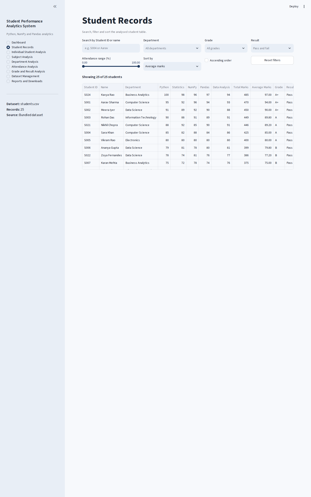
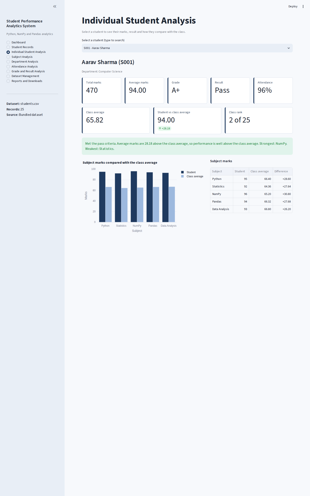
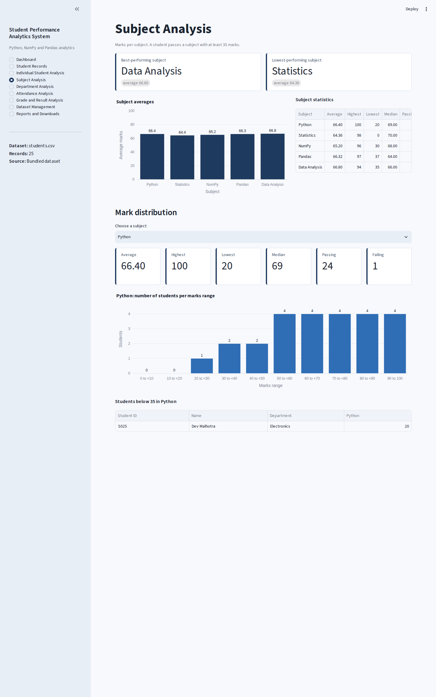
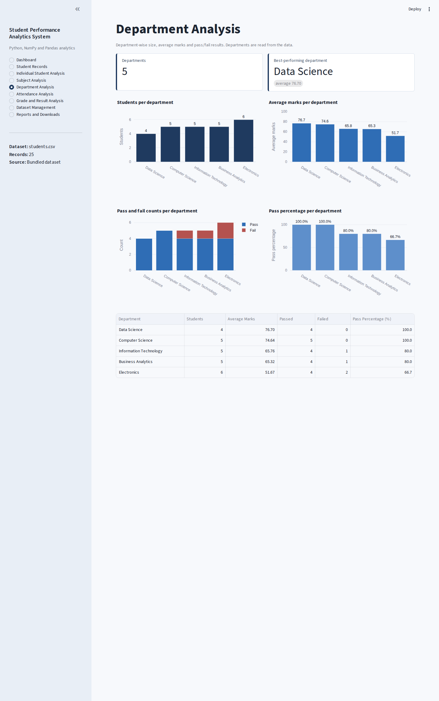
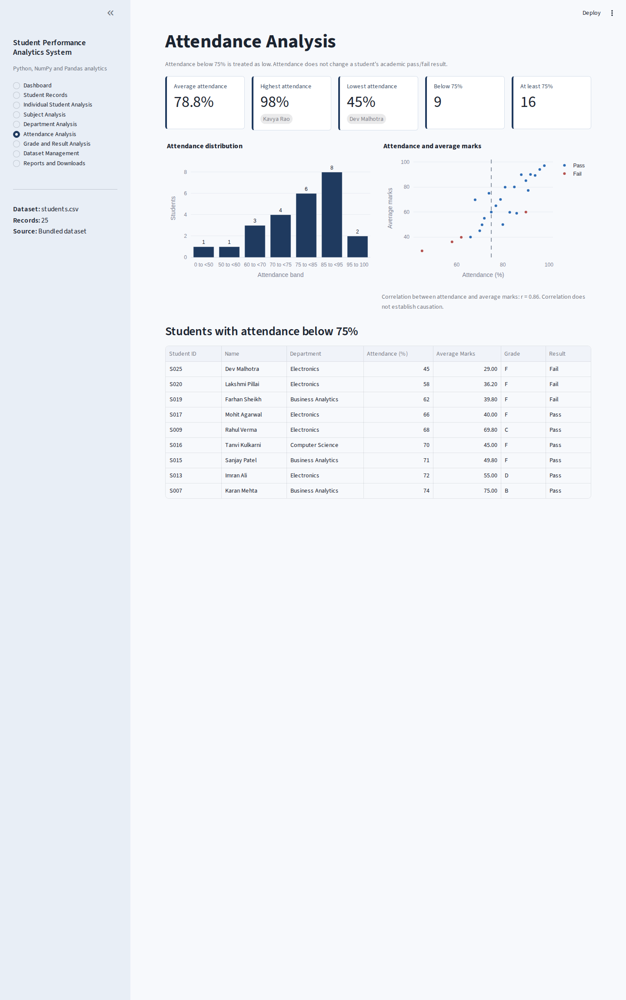
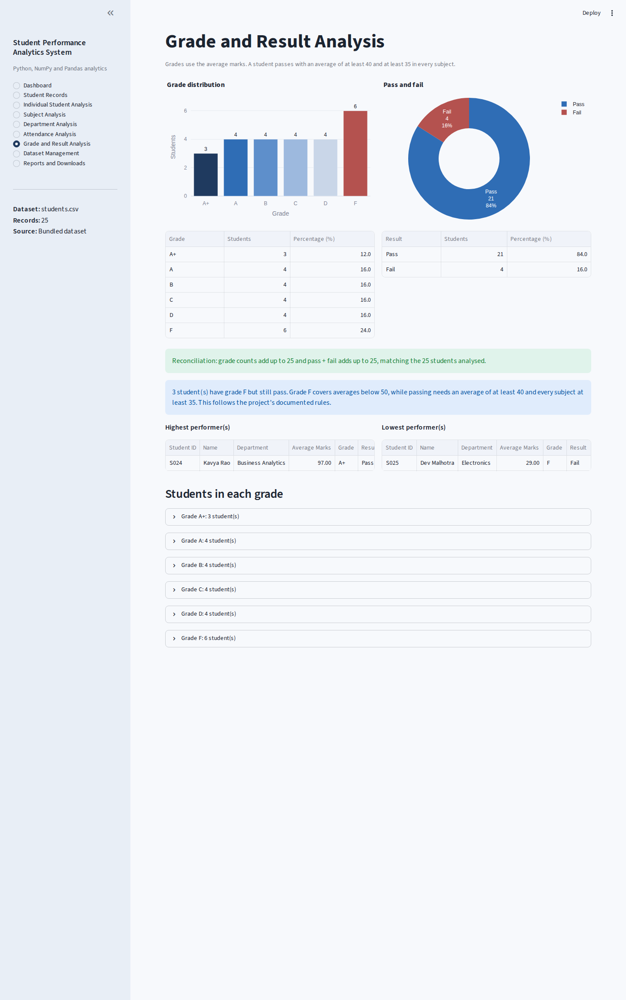
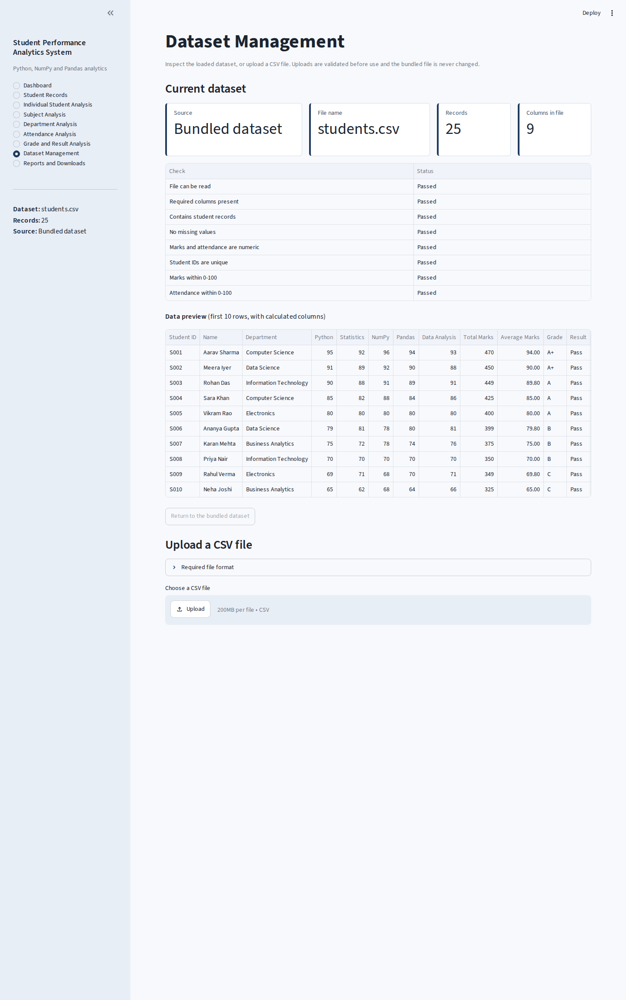
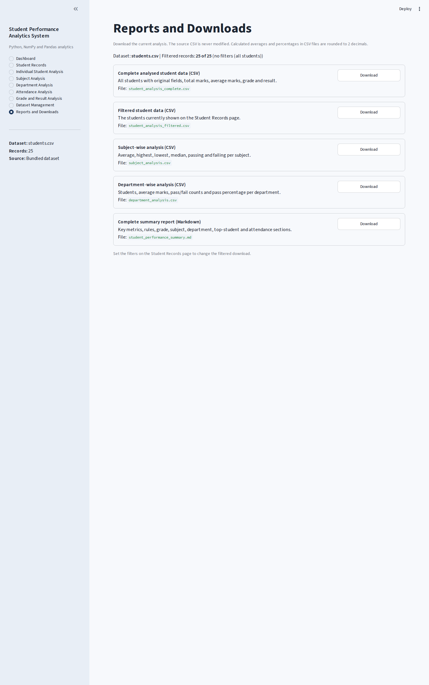
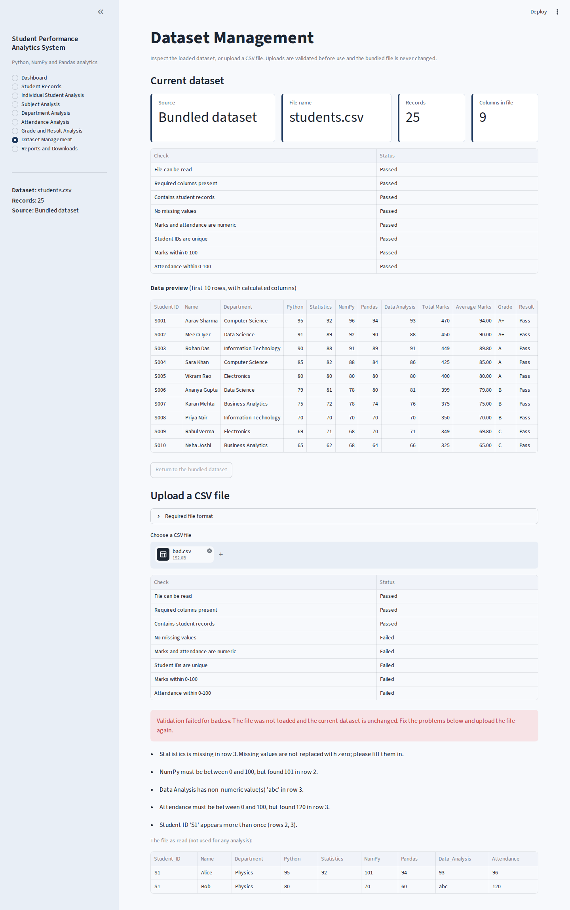
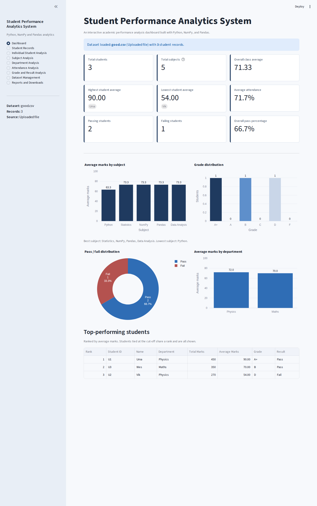

# Project Documentation: Student Performance Analytics System

## 1. Project Title and Student Details

**Project title:** Student Performance Analytics System
**Project type:** Individual Python data-analysis project (EWB Courses, Python with AI)

| Field | Details |
|---|---|
| Student Name | `Aayushman Rajeev Verma` |
| AICTE Student Portal ID | `STU688b856f3cd331753974127` |
| Intership | EWB Courses - EWB/Python with AI |

## 2. Objective

To build a program that reads student data, processes it and produces meaningful results: total marks, average marks, grades, pass/fail statistics, subject-wise performance, highest and lowest performance, and top-performing students. A browser-based graphical interface was added so that the results can be explored interactively, without changing the required Python, NumPy and Pandas analysis.

## 3. Technologies Used

| Technology | Role in the project |
|---|---|
| Python 3 | Variables, data types, loops, functions and conditional statements |
| NumPy | Marks matrix (`students x subjects`), `sum`, `mean`, `median`, `min`, `max`, `corrcoef`, `histogram`, `isclose` |
| Pandas | DataFrames, CSV reading, `groupby`, filtering, sorting, `value_counts`, `cut`, CSV export |
| Streamlit | Local graphical interface (presentation only) |
| Plotly | Interactive charts (presentation only) |
| Pytest | Automated testing |

Streamlit and Plotly only display results. All calculations live in `functions.py`.

## 4. Dataset Description

File: `data/students.csv`. 25 fictional students, five departments (Computer Science, Data Science, Information Technology, Electronics, Business Analytics). No real personal data.

| Column | Meaning |
|---|---|
| `Student_ID` | Unique identifier (S001 to S025) |
| `Name` | Fictional student name |
| `Department` | Department name |
| `Python`, `Statistics`, `NumPy`, `Pandas`, `Data_Analysis` | Subject marks, 0 to 100 |
| `Attendance` | Attendance percentage, 0 to 100 |

The dataset was designed to include high, average and low performers; passes and failures; low and high attendance; averages exactly on grade boundaries (90.0, 80.0, 70.0, 60.0, 50.0) and just below them (89.8, 79.8, 69.8, 59.8, 49.8); an average of exactly 40; a subject mark of exactly 35; a student whose average passes but who fails one subject; a student with a 0 and a student with a 100.

**Rules (project-defined):** Average = total / 5. Grades: A+ (90+), A (80 to <90), B (70 to <80), C (60 to <70), D (50 to <60), F (<50). Pass = average >= 40 and every subject >= 35. Low attendance = below 75%.

## 5. Implementation

**Architecture.** Three layers, with calculations kept out of the interface:

1. `functions.py` loads, validates and analyses data. It contains no Streamlit code.
2. `app.py` is the Streamlit interface. It only calls functions from `functions.py` and displays the results.
3. `main.py` is a command-line report that calls the same functions.

**Core calculation (NumPy and Pandas).** The five subject columns are converted into a NumPy matrix. `marks.sum(axis=1)` gives the total of every student at once, dividing by the number of subjects gives the average, and `marks.min(axis=1)`/row checks support the pass rule. A loop over the students calls the single reusable `calculate_grade()` and `determine_result()` functions (conditional statements) and the results are stored as new DataFrame columns.

**Loops, functions, conditions, variables.** `analyze_students()` loops over students; `subject_statistics()` loops over the subjects; `calculate_grade()` uses an `if` chain over the grade bounds; `main.py` demonstrates `int`, `float`, `str` and `bool` variables taken from the analysis summary.

**Validation.** Before any analysis, `load_students_csv()` checks that the file exists and is readable UTF-8, has a consistent number of fields per row, has all required columns, has at least one record, has no missing values, has only numeric marks and attendance within 0 to 100, and has unique, non-empty student IDs. All problems are reported together. Invalid values are never converted to zero, and an invalid file is never analysed.

**Interface and state.** The sidebar selects one of nine pages. The active dataset (bundled or validated upload) and the Student Records filters are kept in Streamlit session state, so the dashboard, tables, charts, student profile and downloads always use the same data. The bundled CSV is read-only; uploads are held in memory.

**How the GUI and the analysis fit together.** For example, the Dashboard calls `class_summary()`, `subject_statistics()`, `grade_distribution()`, `result_distribution()`, `department_summary()` and `top_students()`; each returns numbers or DataFrames that the page turns into metric cards, Plotly charts and tables. The same functions feed the CSV and Markdown downloads and `main.py`.

**Testing.** `tests/test_analytics.py` tests the engine on a small hand-calculated dataset, all grade and pass/fail boundaries, ties, empty/one-record data, validation and exports. `tests/test_gui.py` uses Streamlit's AppTest to load every page, use filters, select students, upload valid and invalid files, reset the dataset and check that dashboard values equal the engine's values.

## 6. Key Features

- Total marks, average marks, grade and pass/fail for every student
- Class-wide highest/lowest average and total, overall average, pass and fail counts and percentages
- Subject statistics (average, highest, lowest, median, passing, failing), best and lowest subject
- Department comparison with tie-aware best department
- Attendance analysis with a 75% threshold
- Top five students (tie-aware)
- Search, multi-filter and sorting on student records
- Individual student profile with class comparison and written interpretation
- CSV upload with complete validation, safe fallback to the bundled dataset
- Five downloadable reports
- Automated tests for calculations, validation and the interface

## 7. Output / Screenshots

Screenshots were captured from the running application (headless Chromium).

| Page | Screenshot |
|---|---|
| Dashboard |  |
| Student Records |  |
| Individual Student Analysis |  |
| Subject Analysis |  |
| Department Analysis |  |
| Attendance Analysis |  |
| Grade and Result Analysis |  |
| Dataset Management |  |
| Reports and Downloads |  |
| Invalid upload rejected |  |
| Valid upload analysed |  |

**Results for the bundled dataset** (calculated by the program and cross-checked independently): 25 students; class average 65.82; highest average 97.00 (Kavya Rao); lowest 29.00 (Dev Malhotra); 21 pass and 4 fail (84.0% / 16.0%); best subject Data Analysis (66.80), lowest subject Statistics (64.36); best department Data Science (76.70); top five S024, S001, S002, S003, S021; 9 students below 75% attendance.

## 8. Final Outcome

The project delivers a working, interactive analytics system that meets every mandatory requirement of the assignment (dataset of at least 20 records, total/average/grade/pass-fail calculations, subject-wise analysis, highest and lowest performance, top performers) and adds a graphical interface, validation, downloads and automated tests. See `COMPLIANCE_REPORT.md` for the requirement-by-requirement record.

## 9. Challenges & Learning

*The points below are technical issues actually found and fixed while building and testing this version. Add your own reflections in your own words before submitting.*

- **Floating-point precision at grade boundaries.** Adding decimal marks can give totals such as 399.99999999 instead of 400, which would wrongly lower a grade. Totals are rounded to six decimals before the average is graded.
- **Silent data shifting.** Pandas can treat rows with extra fields as an index and shift every column. A field-count check now rejects such files instead of analysing misaligned data.
- **Ties.** "Highest", "best subject", "best department" and "top five" must return every tied item rather than an arbitrary first one.
- **Grade F versus Pass.** Grade F is below 50 but the pass mark is 40, so some students have grade F and still pass. The rules are documented and the interface explains the case.
- **Interface state.** Streamlit forgets widget values when a page is not displayed, so filters are explicitly preserved to keep the Reports page consistent with the Student Records page.
- **Testing the interface.** Writing tests showed two real defects (an invalid table-height argument and a Pandas column-name clash) before they reached a user.

`[ADD YOUR OWN LEARNING NOTES HERE]`

## 10. GitHub Repository

Repository URL: `https://github.com/Aayushman-oss/student-performance-analytics`
