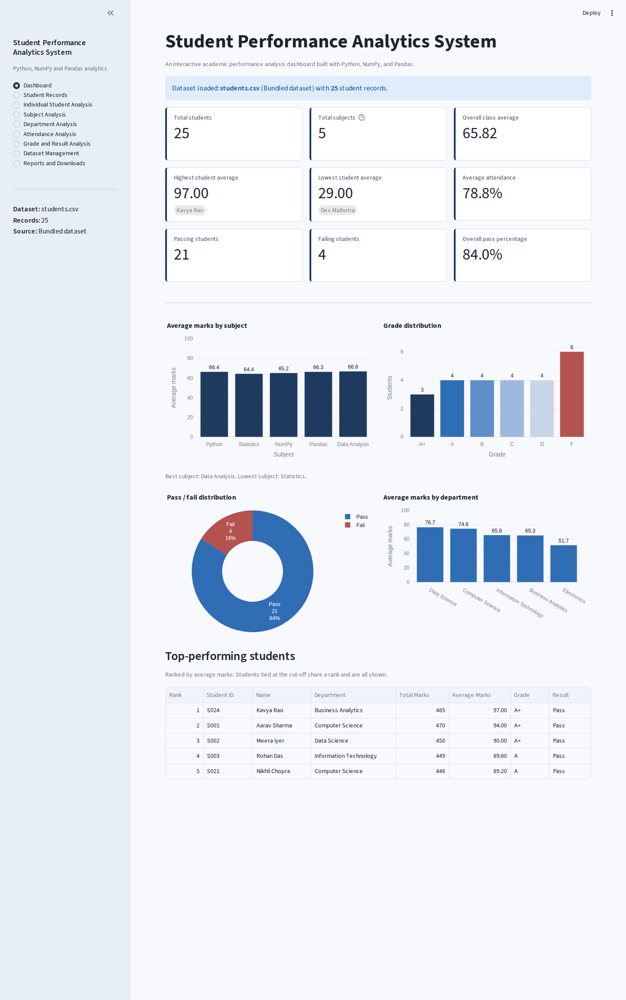

# Student Performance Analytics System

*An interactive academic performance analysis dashboard built with Python, NumPy, and Pandas.*

Individual project for the EWB Courses **Python with AI** assignment.



## 1. Overview

The application reads student records from a CSV file, validates them, calculates total marks, average marks, grades and pass/fail results, and presents the analysis in a local browser-based dashboard (Streamlit). It also includes a command-line report (`main.py`) that uses exactly the same calculation code.

## 2. Problem statement

Teachers and coordinators need a quick, reliable way to see how a class is performing: who is doing well, who needs support, which subjects are weak, and how departments and attendance compare. Doing this by hand is slow and error-prone.

## 3. Objectives

- Read and validate student data with Pandas.
- Calculate totals, averages, grades and pass/fail results with NumPy and Pandas.
- Identify highest and lowest performance, the top five students, and best and lowest subjects.
- Provide a usable graphical interface with filters, charts and downloadable reports.
- Keep one calculation engine so that no two screens can disagree.

## 4. Technologies used

| Technology | Purpose |
|---|---|
| Python 3 | Application language (tested on Python 3.12) |
| NumPy | Marks matrix, totals, averages, medians, correlation, histograms |
| Pandas | Reading CSV, DataFrames, grouping, filtering, sorting, exporting |
| Streamlit | Local graphical interface (presentation only) |
| Plotly | Interactive charts (presentation only) |
| Pytest | Automated tests |

No database, web backend, API key, cloud service or internet connection is needed after installation.

## 5. Project features

- Total marks, average marks, grade and pass/fail for every student.
- Class metrics: overall average, highest/lowest average and total, pass/fail counts and percentages.
- Subject-wise average, highest, lowest, median, passing and failing counts; best and lowest subject.
- Department-wise size, average marks, pass/fail counts, pass percentage and best department (ties handled).
- Attendance statistics and a list of students below 75%.
- Top five students with tie handling.
- Search, filters and sorting on the student table.
- CSV upload with full validation, with the bundled dataset kept safe.
- Five downloadable reports.

## 6. GUI pages

| Page | What it shows |
|---|---|
| Dashboard | Nine metric cards, subject-average, grade, pass/fail and department charts, top-five table, loaded file name and record count |
| Student Records | Full table with search (ID or name), filters (department, grade, result, attendance range), sorting, live record count, reset button |
| Individual Student Analysis | Searchable student selector, marks, total, average, grade, result, attendance, class rank, student-vs-class chart and a written interpretation |
| Subject Analysis | Per-subject statistics table and chart, best/lowest subject, mark-distribution chart for a chosen subject |
| Department Analysis | Students, average marks, pass/fail counts and pass percentage per department, best department |
| Attendance Analysis | Average/highest/lowest attendance, counts below and above 75%, distribution chart, low-attendance table, attendance-vs-marks scatter |
| Grade and Result Analysis | Grade and pass/fail distributions, students in each grade, highest/lowest performers, reconciliation check |
| Dataset Management | Current dataset details, validation checklist, CSV upload, preview, return to bundled dataset |
| Reports and Downloads | Five download buttons (see section 15) |

More screenshots are in the `screenshots/` folder.

## 7. Dataset schema

`data/students.csv` contains **25 fictional students** in five departments.

| Column | Type | Rule |
|---|---|---|
| `Student_ID` | text | Required, unique |
| `Name` | text | Required |
| `Department` | text | Required |
| `Python`, `Statistics`, `NumPy`, `Pandas`, `Data_Analysis` | number | Required, 0 to 100 |
| `Attendance` | number | Required, 0 to 100 (percent) |

The five subject columns are listed explicitly in `functions.py` (`SUBJECTS`), so `Student_ID` and `Attendance` can never be treated as subjects. The dataset deliberately includes marks near every grade boundary, averages of exactly 40, a subject mark of exactly 35, an average above 40 with one failing subject, attendance of exactly 75, and a 0 and a 100 mark.

## 8. Grading and pass/fail rules

These rules are **project-defined** (the assignment does not prescribe them) and are implemented once in `calculate_grade()` and `determine_result()` in `functions.py`.

| Average marks | Grade |
|---|---|
| 90 to 100 | A+ |
| 80 to below 90 | A |
| 70 to below 80 | B |
| 60 to below 70 | C |
| 50 to below 60 | D |
| Below 50 | F |

- `Total_Marks` = sum of the five subject marks. `Average_Marks` = `Total_Marks / 5`.
- A student **passes** if the average is **at least 40** and **every subject is at least 35**. Otherwise the student fails.
- A subject is "passed" by a student with at least 35 marks in it.
- Attendance below **75%** is "low attendance". It is informational only and never changes a result.
- **Note:** because grade F means an average below 50 but passing only needs an average of 40, a student with an average between 40 and 49.99 has **grade F and result Pass**. This follows the rules above and the application points it out on the Grade and Result page.
- The top five uses competition ranking (1, 2, 2, 4): students tied at the cut-off all appear, and with fewer than five students all are shown.
- Full precision is used in calculations. Rounding is only for display and CSV export (averages and percentages to 2 decimals).

## 9. Folder structure

```
student-performance-analytics/
├── app.py                    Streamlit interface (presentation only)
├── main.py                   Command-line report using the same engine
├── functions.py              Validation and all calculations
├── data/students.csv         Fictional dataset (25 students)
├── requirements.txt
├── README.md
├── Project_Documentation.md  Formal documentation (10 sections)
├── Viva_Questions_and_Answers.md
├── COMPLIANCE_REPORT.md      Requirement-by-requirement verification record
├── .gitignore
├── .streamlit/config.toml    Light theme
├── tests/
│   ├── __init__.py
│   ├── test_analytics.py     Engine tests
│   └── test_gui.py           Interface tests
├── outputs/.gitkeep          Generated reports go here (python main.py --export)
└── screenshots/              Screenshots of the running application
```

## 10. Installation (Windows, VS Code)

Requires Python 3.10 or newer from [python.org](https://www.python.org/downloads/) (tested on 3.12). The test suite passed with both the newest packages (Streamlit 1.66, pandas 3.0, NumPy 2.5, Plotly 7.1) and the oldest versions allowed by `requirements.txt` (Streamlit 1.66, pandas 2.2.3, NumPy 2.0.2, Plotly 5.24.1). Open the project folder in VS Code, open a terminal (PowerShell), then:

Create a virtual environment:

```powershell
py -m venv .venv
```

Activate it:

```powershell
.\.venv\Scripts\Activate.ps1
```

Install the dependencies:

```powershell
python -m pip install -r requirements.txt
```

**If PowerShell blocks activation** ("running scripts is disabled"), skip activation and call the virtual environment's Python directly:

```powershell
.\.venv\Scripts\python.exe -m pip install -r requirements.txt
.\.venv\Scripts\python.exe -m streamlit run app.py
.\.venv\Scripts\python.exe -m pytest -q
```

(Alternatively allow scripts for the current terminal only with `Set-ExecutionPolicy -Scope Process -ExecutionPolicy Bypass`, then activate again.)

## 11. Launching the GUI

```powershell
python -m streamlit run app.py
```

Streamlit starts a small **local web server** on your computer and normally opens the application in your default browser. If the browser does not open, copy the **Local URL printed in the terminal** (for example `http://localhost:8501`) into your browser. Use the address the terminal prints, because the port can differ if 8501 is already in use. Press `Ctrl+C` in the terminal to stop the server. The first launch may ask for an optional email; press Enter to skip.

## 12. Command-line report (optional)

```powershell
python main.py              # print the full analysis
python main.py --file my.csv
python main.py --export     # also write reports to outputs/
```

## 13. Running the tests

```powershell
python -m pytest -q
```

The suite has engine tests (calculations, boundaries, ties, validation, filters, exports) and interface tests (every page, filters, student selection, upload, reset, invalid files). It needs no internet connection.

## 14. Using the application

1. Start on **Dashboard** for the overview.
2. Use **Student Records** to search and filter. The filters stay in place while you visit other pages, and the *filtered* download uses them.
3. Use **Dataset Management** to upload your own CSV. A valid file shows a preview and a **Use this dataset for analysis** button; an invalid file is rejected with every problem listed, and nothing changes. **Return to the bundled dataset** restores `data/students.csv`. Uploads last for the browser session and never overwrite the bundled file.

## 15. Downloading reports

Open **Reports and Downloads**. Each report has its own Download button:

| File | Content |
|---|---|
| `student_analysis_complete.csv` | All students with original fields, `Total_Marks`, `Average_Marks`, `Grade`, `Result` |
| `student_analysis_filtered.csv` | Only the students currently selected by the Student Records filters |
| `subject_analysis.csv` | Subject statistics |
| `department_analysis.csv` | Department statistics |
| `student_performance_summary.md` | Readable summary report with key metrics, rules and tables |

## 16. Troubleshooting

| Problem | Fix |
|---|---|
| `streamlit` is not recognised | Use `python -m streamlit run app.py` and make sure the virtual environment is active (or use `.\.venv\Scripts\python.exe`) |
| PowerShell blocks `Activate.ps1` | See the alternative in section 10 |
| `py` is not recognised | Reinstall Python and tick "Add Python to PATH" / the Python launcher, or use `python -m venv .venv` |
| Browser did not open | Copy the Local URL printed in the terminal |
| Port already in use | Streamlit chooses another port automatically; use the URL it prints, or run `python -m streamlit run app.py --server.port 8502` |
| `ModuleNotFoundError` | Activate the virtual environment and re-run the install command |
| Upload rejected | Read the listed problems: column names must match exactly (section 7), every cell filled, marks and attendance between 0 and 100, unique IDs, UTF-8 CSV, every row with the same number of fields as the header |
| Tests cannot import modules | Run `python -m pytest -q` from the project folder |

## 17. GitHub submission

Create an empty public repository named `student-performance-analytics` on GitHub (no README, no .gitignore), then in the project folder:

```powershell
git init
git add .
git commit -m "Student Performance Analytics System"
git branch -M main
git remote add origin https://github.com/<your-username>/student-performance-analytics.git
git push -u origin main
```

Then:

1. Open the repository in a private/incognito browser window to confirm it is public and shows all files.
2. Copy the repository URL from the address bar.
3. Submit that URL through the official EWB Google Form.
4. Replace the placeholders in `Project_Documentation.md` (your details and the repository URL), commit and push again.

Nothing has been pushed or submitted on your behalf.

## 18. Known limitations

- Department and subject names are matched exactly; "data science" and "Data Science" would count as different departments.
- Uploaded datasets live only in the browser session (they are not saved to disk).
- Row numbers in error messages count the header as row 1 and assume no blank lines in the file.
- Files must be UTF-8 CSV with the exact column names; a trailing extra comma on a row is rejected rather than guessed at.
- Interface behaviour was verified on Linux with Python 3.12 using automated tests and a headless Chromium browser. The Windows PowerShell commands above are standard but were **not executed** on Windows during development.
- Correlation shown on the Attendance page is descriptive only; it does not establish causation.
